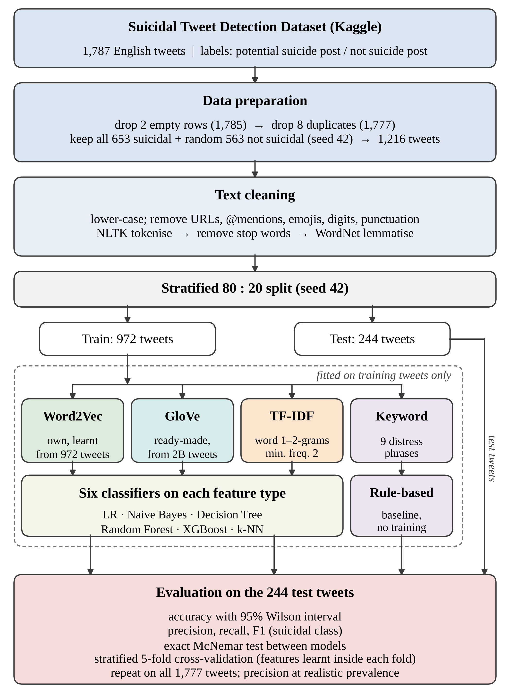
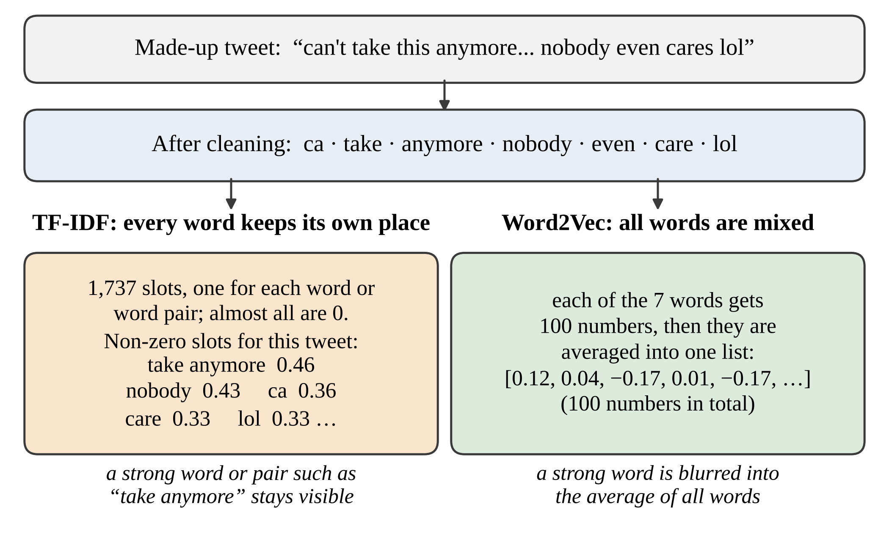
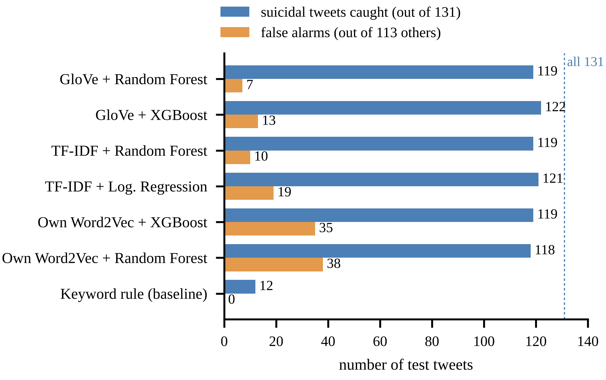

# Sravana: Listening to Tweets

**Signs of suicidal ideation in tweets: comparing Word2Vec and TF-IDF features with classical classifiers**

*Sravana* is the Sanskrit word for "listening".

This repository contains the complete, reproducible code for the paper:

> S. Barik and A. Ghosh, *"Sravana: Listening to Tweets for Signs of Suicidal Ideation, Comparing Word2Vec and TF-IDF Features with Classical Classifiers,"* submitted to the IEEE International Conference on Research in Computational Intelligence and Communication Networks (ICRCICN 2027), Kalyani, India.

Every number, table and confusion matrix in the paper is produced by the scripts here. A full run takes about 30 seconds on an ordinary laptop.

> [!IMPORTANT]
> This is **research code for studying text**. It is **not** a diagnostic, screening or crisis tool, and it must not be used to make decisions about real people. If you or someone you know is struggling, please contact a local helpline or a mental health professional. See [docs/ETHICS.md](docs/ETHICS.md).

---

## The story in one minute

People who are struggling often write about it online before they speak to anyone. We asked a simple question: **can a computer read short tweets and gently flag the ones that show signs of suicidal thoughts?**

Using 1,216 annotated English tweets, we turned every tweet into numbers in **three ways** and gave each to the **same six classical classifiers** (18 combinations), and checked them against a simple **keyword rule**:

* **Word2Vec, our own**: learnt from only the 972 training tweets;
* **GloVe, ready-made**: word vectors learnt by other researchers from about 2 billion tweets;
* **TF-IDF**: plain word and word-pair counts.

What we found:

* Word vectors learnt from our own small data were the **weakest**: about **85%** accuracy in 5-fold cross-validation (best: XGBoost and Random Forest), with many false alarms.
* **Ready-made GloVe vectors and TF-IDF counts both reached about 90%.** The best test result was **92.2%** (GloVe + Random Forest: caught 119 of 131 suicidal tweets with only 7 false alarms), statistically tied with **TF-IDF + Random Forest (91.0%)** (exact McNemar *p* = 0.69).
* GloVe beat our own Word2Vec with 5 of 6 classifiers, and TF-IDF with 4 of 6 (McNemar *p* < 0.01).
* Skipping the balancing step and using **all 1,777 tweets** gives the same order (TF-IDF + RF 91.2%, GloVe + XGBoost 91.0%, own Word2Vec + RF 87.1% in cross-validation).
* A **keyword rule** caught only 12 of 131 suicidal tweets, so the models learn much more than a list of obvious phrases.

**In real life:** suicidal posts are rare. With the best model, if only 5% of tweets were truly suicidal, about 43% of alerts would be correct; at 1%, about 13% (1 in 8). Every alert must be checked by a trained person.

**Lesson:** word vectors are only as good as the text they learnt from. Learnt from a few hundred tweets they are weak; borrowed from billions of tweets they are as good as simple word counts. Always test a simple baseline, and give every method a fair chance.

---

## Results at a glance

Held-out test set: 244 tweets (131 suicidal, 113 not). Acc = test accuracy; P, R, F1 for the suicidal class; CV = mean 5-fold cross-validation accuracy.

| Classifier | Own Word2Vec Acc | CV | GloVe Acc | CV | TF-IDF Acc | CV |
|---|---|---|---|---|---|---|
| Logistic Regression | 0.770 | 0.800 | 0.889 | 0.868 | 0.881 | 0.892 |
| Gaussian Naive Bayes | 0.754 | 0.754 | 0.857 | 0.827 | 0.791 | 0.844 |
| Decision Tree | 0.758 | 0.782 | 0.852 | 0.778 | 0.873 | 0.861 |
| Random Forest | 0.791 | 0.849 | **0.922** | 0.901 | **0.910** | 0.905 |
| XGBoost | 0.807 | 0.849 | 0.910 | 0.877 | 0.889 | 0.879 |
| k-NN | 0.754 | 0.800 | 0.791 | 0.770 | 0.500 | 0.522 |

Keyword rule baseline: accuracy 0.512, precision 1.000, recall 0.092.

Full numbers (precision, recall, F1, confidence intervals, confusion counts, McNemar tests, the all-1,777-tweet check) are in [`results/extended/`](results/extended/) and [docs/RESULTS.md](docs/RESULTS.md).

---

## Figures

| How the study works | One tweet turned into numbers | Caught vs. false alarms |
|---|---|---|
|  |  |  |

The scripts in [`figures/`](figures/) redraw these images (run them from the repository's top folder). The numbers in `tweet_to_numbers` and `caught_vs_false` come from `results/` and the trained models.

---

## Quick start

```bash
# 1. Get the code
git clone https://github.com/SudipBarik-tech/Listening-to-Tweets.git
cd Listening-to-Tweets

# 2. Install the Python packages (Python 3.9 or newer)
pip install -r requirements.txt
python -c "import nltk; [nltk.download(p) for p in ['punkt','punkt_tab','stopwords','wordnet','omw-1.4']]"

# 3. Put the dataset in data/ (see "Data" below), then:
python prepare_data.py                                        # builds data/tweets_balanced.csv
python run_experiments.py --data data/tweets_balanced.csv     # own Word2Vec models + baselines -> results/
python robustness_seeds.py                                    # optional: 10 random splits

# 4. The full comparison in the paper's Table III (needs the GloVe file, about 400 MB):
curl -L -o glove-twitter-100.gz https://github.com/RaRe-Technologies/gensim-data/releases/download/glove-twitter-100/glove-twitter-100.gz
python extended_experiments.py --data data/tweets_balanced.csv --full data/tweets_full.csv \
       --glove glove-twitter-100.gz --outdir results/extended   # about 4 minutes
python make_table.py --indir results/extended                   # rows of Table III
```

Step-by-step instructions, including Google Colab and Kaggle Notebooks and a troubleshooting section, are in [docs/REPRODUCING.md](docs/REPRODUCING.md).

---

## Data

We use the public **Suicidal Tweet Detection Dataset** by Syeda Aunanya Mahmud (2023):

* Kaggle: <https://www.kaggle.com/datasets/aunanya875/suicidal-tweet-detection-dataset>
* File: `Suicide_Ideation_Dataset(Twitter-based).csv` (1,787 tweets; columns `Tweet`, `Suicide`)
* Licence: **CC BY-NC-SA 4.0** (non-commercial use; please cite the dataset)

The tweets are **not** included in this repository. Download the CSV and place it at `data/Suicide_Ideation_Dataset(Twitter-based).csv`. The dataset card, with counts at every step, is in [docs/DATA.md](docs/DATA.md).

---

## Repository layout

```
Listening-to-Tweets/
├── README.md                 ← you are here
├── requirements.txt          ← Python packages
├── CITATION.cff              ← how to cite this work
├── prepare_data.py           ← raw CSV  → balanced 1,216-tweet dataset (+ all 1,777 tweets)
├── run_experiments.py        ← own-Word2Vec models, baselines, statistics, confusion matrices
├── extended_experiments.py   ← own Word2Vec vs GloVe vs TF-IDF, six classifiers each (Table III)
├── make_table.py             ← builds the rows of Table III from results/extended/
├── robustness_seeds.py       ← repeats the evaluation over 10 random splits
├── figures/                  ← the three paper figures and the scripts that draw them
├── data/                     ← put the downloaded CSV here (ignored by git)
├── results/                  ← every output used in the paper
│   ├── extended/             ← Table III: test_results.csv, cv_results.csv, mcnemar_vs_w2v.txt,
│   │                            full_data_cv.csv (all 1,777 tweets), table_wide.tex
│   ├── table1_rows.tex       ← own-Word2Vec rows (earlier table layout)
│   ├── cv_results.csv        ← 5-fold cross-validation, mean and SD
│   ├── mcnemar.txt           ← exact McNemar test for every pair of models
│   ├── robustness_seeds.csv  ← 10-split robustness summary
│   ├── settings.txt          ← seed, library versions, all hyperparameters
│   ├── preprocess_example.txt← cleaning example shown in the paper
│   └── cm_*.jpg              ← confusion matrices (paper Fig. 3)
└── docs/
    ├── METHODS.md            ← every step of the pipeline, with parameters
    ├── REPRODUCING.md        ← detailed run guide and troubleshooting
    ├── RESULTS.md            ← full results and how to read them
    ├── DATA.md               ← dataset card
    └── ETHICS.md             ← responsible-use statement
```

---

## How it works (short version)

1. **Prepare data** (`prepare_data.py`): drop 2 empty rows → remove 8 exact duplicates → keep all 653 suicidal tweets and a random 563 non-suicidal tweets (seed 42).
2. **Clean text**: lower-case; remove URLs, @mentions, emojis, digits, punctuation; NLTK tokenise; remove stop words; WordNet lemmatise.
3. **Split**: stratified 80:20 → 972 training and 244 test tweets (seed 42).
4. **Features** (three kinds):
   * own skip-gram Word2Vec (100-d, window 5, min count 2, 20 epochs) trained on **training tweets only**; a tweet = the average of its word vectors;
   * ready-made GloVe Twitter vectors (100-d, Pennington et al. 2014, learnt from ~2 billion tweets); a tweet = the average of its word vectors;
   * TF-IDF (word 1–2-grams, min df 2), fitted on training tweets only.
5. **Models** (each with each feature type): Logistic Regression, Gaussian NB, Decision Tree, Random Forest (300 trees), XGBoost (300 trees), k-NN (k = 5).
6. **Baseline**: a 9-phrase keyword rule, fixed before any model was trained.
7. **Evaluation**: accuracy with 95% Wilson CIs; suicidal-class precision, recall, F1; exact McNemar tests; stratified 5-fold CV with Word2Vec and TF-IDF re-learnt inside each fold; the same CV on all 1,777 tweets without balancing.

The full, detailed description is in [docs/METHODS.md](docs/METHODS.md).

---

## Citation

If you use this code, please cite the paper and the dataset (see [CITATION.cff](CITATION.cff)):

```bibtex
@inproceedings{barik2027listening,
  title     = {Sravana: Listening to Tweets for Signs of Suicidal Ideation, Comparing Word2Vec and TF-IDF Features with Classical Classifiers},
  author    = {Barik, Sudip and Ghosh, Ammlan},
  booktitle = {IEEE International Conference on Research in Computational Intelligence and Communication Networks (ICRCICN)},
  year      = {2027},
  note      = {Submitted}
}

@misc{mahmud2023suicidal,
  title        = {Suicidal Tweet Detection Dataset},
  author       = {Mahmud, Syeda Aunanya},
  year         = {2023},
  howpublished = {\url{https://www.kaggle.com/datasets/aunanya875/suicidal-tweet-detection-dataset}},
  note         = {CC BY-NC-SA 4.0}
}
```

## Authors

* **Sudip Barik**, Department of Master of Computer Application, Techno International New Town, Kolkata, India (sudip.barik@tint.edu.in)
* **Ammlan Ghosh**, Department of Artificial Intelligence and Data Science, Saveetha School of Engineering, Chennai, India (ammlanghosh.sse@saveetha.com)

## Licence

The authors have not yet chosen a licence for this code. Until a `LICENSE` file is added, all rights are reserved by the authors. The dataset keeps its own CC BY-NC-SA 4.0 licence.
